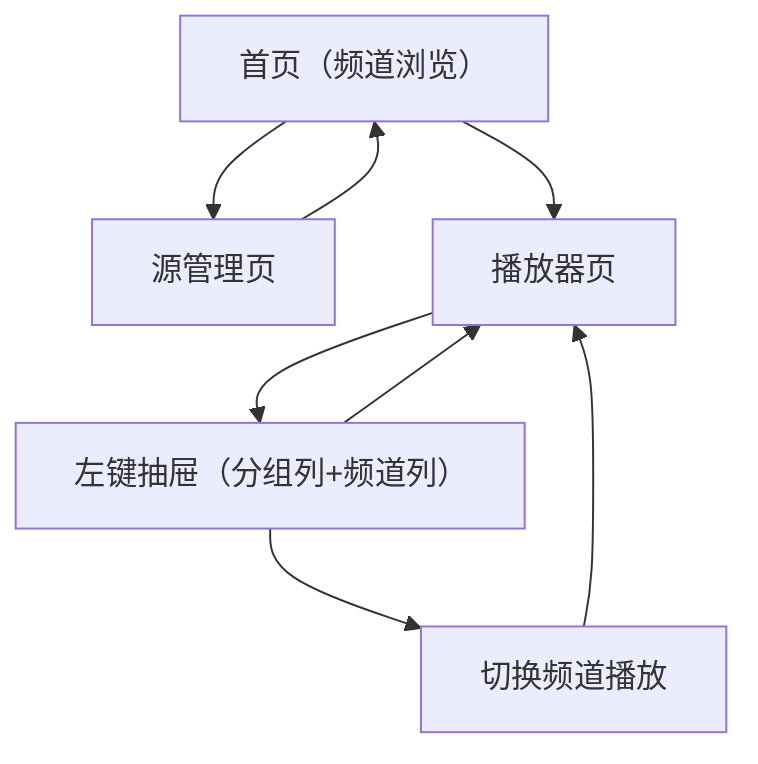

## 1. Product Overview
一款深色风格的 Android TV IPTV 播放器，支持导入/加载 m3u 等直播源并播放频道视频。
面向电视遥控器操作场景，提供“分组-频道-播放”的快速切换体验。

## 2. Core Features

### 2.1 Feature Module
本产品最小可用版本包含以下页面：
1. **首页（频道浏览）**：直播源导入/选择、分组列表、频道列表、进入播放。
2. **播放器页**：视频播放、左键抽屉（分组列+频道列）、频道切换、台标展示。
3. **源管理页**：添加/编辑/删除直播源、手动刷新解析。

### 2.3 Page Details
| Page Name | Module Name | Feature description |
|-----------|-------------|---------------------|
| 首页（频道浏览） | 直播源入口 | 导入 m3u（本地文件/URL 二选一实现即可），选择当前使用的直播源，触发解析并展示结果。 |
| 首页（频道浏览） | 分组与频道浏览 | 展示分组列表与对应频道列表；支持遥控器上下移动焦点、点击频道进入播放。 |
| 首页（频道浏览） | 最近播放（可选） | 展示最近播放频道，支持一键继续播放（不影响核心流程）。 |
| 播放器页 | 播放控制 | 播放当前频道流；在界面上显示频道名等基础信息（必要时自动隐藏）。 |
| 播放器页 | 左键抽屉 | 按遥控器左键打开抽屉；抽屉从左到右为“分组列”和“频道列”；抽屉打开后焦点进入抽屉并可关闭回到视频区域。 |
| 播放器页 | 频道列台标 | 在频道项展示台标（logo）；无台标时显示占位图/首字母占位；台标加载失败需降级不影响切台。 |
| 播放器页 | 快速切台 | 在抽屉内选择频道后立即切换播放；保留当前分组选择状态以便连续切换。 |
| 源管理页 | 源列表管理 | 展示已添加源；支持新增、编辑名称与地址、删除；支持手动刷新（重新拉取并解析）。 |

## 3. Core Process
- 普通用户流程：打开应用 → 在首页导入/选择直播源 → 解析后浏览分组与频道 → 选择频道进入播放器 → 播放器中按左键打开抽屉 → 在分组列切换分组/在频道列选择频道 → 立即切台播放 → 关闭抽屉回到视频。

## 4. 老白需求补充与接手验收（2026-11-18）

### 4.1 当前产品方向

以 tivimini 的 Android TV Compose 界面与遥控器交互为基础，直接移植后再按老白的 IPTV 使用场景做二次改进。不要把 iqtvlite 的旧 UI 当作设计基线。播放器只用 Android TV 遥控器操作；播放列表测试地址固定为 `https://iptv.laobaitv.net`。

手机扫码推送必须保留。测试地址只是电视端首次配置页的预填默认值，不代表删除/禁用扫码配置，也不代表只能配置这一条源。

### 4.2 必须保持的体验

- 首次进入源配置页，直播源预填 `https://iptv.laobaitv.net`，EPG 预填 `https://epg.laobaitv.net`；二维码和局域网推送入口仍可见、可用。
- 遥控器数字键连续输入频道号，例如 `112`：输入期间有清楚的号码反馈，短暂等待后切到第 112 号频道；无此频道时显示明确提示。数字键不能被输入框、抽屉或系统键盘无意吞掉。
- 遥控器上下换台、上一台、频道/节目单抽屉、设置/源配置之间的职责要清楚；日常换台不能误进源配置。
- 频道台标保留原图透明效果，不叠加卡片边框；换台信息显示台名、台标、正在播放及接下来播放。
- 设置和节目单是分开的交互。抽屉靠屏幕一侧、透明显示，尽量保留节目画面可见。
- 视觉统一，以 tivimini 的简洁灰阶为起点，再做统一品牌资产；不能因品牌改造破坏扫码推源和遥控焦点提示。

### 4.3 播放列表与网络兼容

- IPTV 测试播放列表：`https://iptv.laobaitv.net`；EPG：`https://epg.laobaitv.net`。
- M3U 频道可能有 `http-user-agent="VLC"`，需要解析为频道级 UA，并在实际 Media3 请求中生效；不得只解析但不传给播放器。
- 某些 Android TV 网络的 IPv6 出口不可用；播放列表、EPG 和流播放网络栈都要验证 IPv4 优先行为。
- EPG 可能是没有 `Content-Encoding` 头的裸 gzip，按 `1f 8b` magic 解压。当前 tivimini 的 `EpgRepository.parseFile()` 已按 gzip magic 解压缓存文件；网络下载和缓存流程仍需实测。
- URL 重定向行为需以实时响应验证，不要预设 endpoint 一定 302。2026-11-18 的 curl 检查 `https://iptv.laobaitv.net` 返回 HTTP 200、`application/x-mpegURL`、156 条 `#EXTINF`，当时未发生重定向。

### 4.4 接手验收标准

- [ ] 原版 tivimini 核心 UI/遥控器流在目标盒子上可用，后续 UI 改造以该代码为基础。
- [ ] 首次配置页实测显示两个预填地址和二维码；手机扫码推送仍能覆盖/更新源并启动播放。
- [ ] 用遥控器真实输入 `112`，屏幕显示完整输入缓冲并跳到 112 号频道；再测试有效边界号和无效号码。
- [ ] 数字跳台选择后验证实际 HTTP 请求、ExoPlayer 状态和首帧；频道列表索引必须与实际频道编号约定一致。
- [ ] 选一个服务端确认可用的频道做稳定播放验证；区分服务端 HTTP 错误与 app 行为。
- [ ] 用 `http-user-agent="VLC"` 的 M3U 条目确认发出的请求 UA 为 `VLC/3.0.20 LibVLC/3.0.20`；再确认默认 UA 不被污染。
- [ ] 实测 EPG gzip、播放列表重定向、IPv4 优先 DNS、台标透明显示和节目单匹配。
- [ ] 设置与节目单分开呼出；所有抽屉/侧栏不超过屏幕约 1/3，视频仍可见。
- [ ] CI/build、单测、目标机安装与端到端验证全通过后才可打 Release/tag。

### 4.5 当前实现状态与未决项

具体文件、构建结果、真机现状、失败项和下一步见仓库根目录 `HANDOFF.md`。当前工作区仍有未提交改动；不得将其描述为已发布版本。
