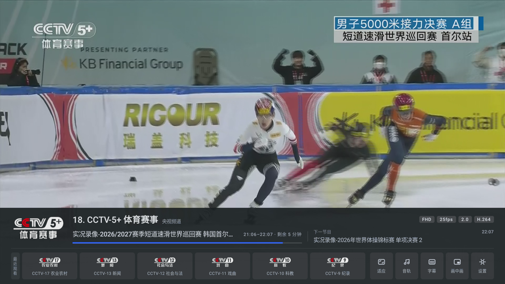
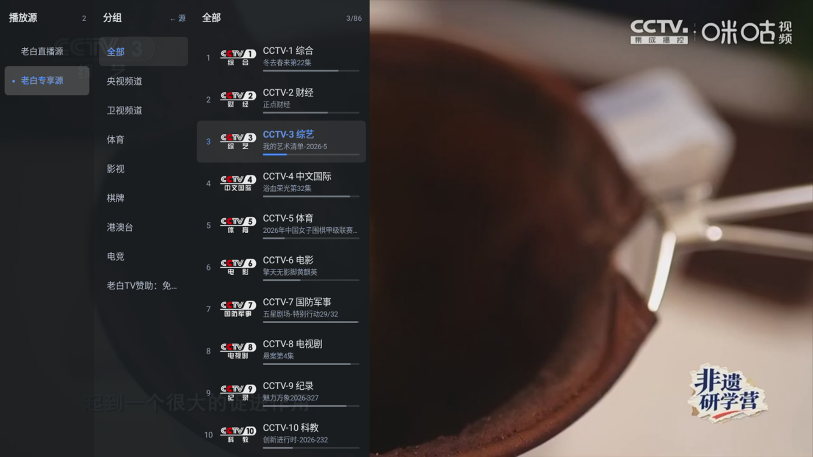
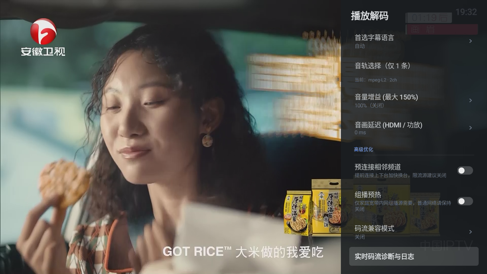

  

    <picture>
      <source media="(prefers-color-scheme: dark)" srcset="assets/logo-white-transparent.png" />
      <source media="(prefers-color-scheme: light)" srcset="assets/logo-transparent.png" />
      
    </picture> 
    <strong>A clean, lightweight, fast-zapping IPTV player for Android TV &amp; TV boxes</strong> 
    D-pad first · Hardware 4K HEVC/HDR · Direct RTP/UDP Multicast · Zero-PIN LAN WebUI
  

  

    
    
    
    
    
    
  

  

    <b>English</b> ·
    <a href="README.zh-CN.md">简体中文</a> ·
    <a href="https://zqs1qiwan.github.io/iqtvlite/#en/home">📖 User Wiki (GitHub Pages)</a>
  

---

**IQTV Lite** is a native **Android TV** IPTV **player** built with Jetpack Compose for TV, Media3 ExoPlayer, and a Rust native core (`iqtvlite-capi`), engineered to stay snappy even on 512 MB–1 GB set-top boxes while delivering 4K HDR &amp; native LAN multicast playback.

> ⚠️ **Player Only:** IQTV Lite ships **no** built-in channels, playlists, EPG sources, or subscriptions. You bring your own M3U/TXT playlists and XMLTV guides.

> ### 📖 New here? **[Open Project Home &amp; User Wiki →](https://zqs1qiwan.github.io/iqtvlite/#en/home)**
> Full feature guides, multicast setup, remote keymaps, troubleshooting, and diagnostics — searchable in English &amp; Chinese.

---

## ✨ Features

### 🎬 Playback, Decoders &amp; Display
- **Hardware-First Ladder + Per-Channel Override**: Prioritizes `MediaCodec` hardware decoding (with 4K HEVC/HDR capabilities workarounds for legacy TV box firmwares) and gracefully falls back to decoder rebuild / FFmpeg on failure, while letting you pin **Force Hardware** or **Force Software** per channel.
- **Auto Frame Rate Matching (AFR)**: Debounced `1,200 ms` refresh-rate matching (`23.976` / `25 → 50Hz` / `29.97 → 59.94Hz`) with zero downscaling and zero HDMI flicker while channel surfing.
- **4K Anti-Artifacting**: Optional decoder reset when tuning into UHD/4K feeds to prevent green frames on older SoCs.
- **Audio-Only Mode &amp; Dual-Screen Multi-view**: Toggle video decoding off from the quick action bar for radio/background listening, or watch two live channels side-by-side via in-app PiP.

### 🔊 Audio Tuning
- **Per-Route Audio Delay (`±500 ms`)**: Independent lip-sync offsets remembered per output device (**Speaker**, **Bluetooth Audio**, **HDMI / ARC**).
- **150% Volume Boost**: Zero-dependency soft-clipped PCM loudness gain (`100%–150%`) with exact bypass (`0` CPU / `0` allocations) when untouched.

### 🌐 Networking, Multicast &amp; EPG
- **Direct `rtp://` / `udp://` Multicast Engine**: Dedicated non-blocking socket reader with a **4 MB ring buffer** and dynamic Wi-Fi multicast locks alongside standard HTTP/udpxy support.
- **Dual-Stack IPv6 / IPv4 Preference**: Configurable IPv6-first (default) or IPv4-first resolution with seamless secondary-family fallback.
- **Zero-Dependency RFC 8484 Encrypted DNS (DoH)**: Built-in **System DNS (Default)**, **AliDNS (`223.5.5.5`)**, **Tencent DNSPod (`doh.pub`)**, and **Cloudflare (`1.1.1.1`)** with a 256-entry TTL cache, LAN/IP bypass, and automatic system fallback.
- **SQLite EPG + `±12h` Guide Offset**: Off-thread XMLTV indexing into SQLite for millisecond channel switching, plus instant query-time timezone offset (`-12h .. +12h`).

### 📱 LAN WebUI &amp; Diagnostics
- **Zero-PIN Home LAN WebUI**: Scan the TV QR code from your phone to add multiple sources, edit global User-Agent / HTTP headers, tune network/EPG settings, and **export/restore full JSON config backups**.
- **Live Stream Diagnostics &amp; `/api/diag`**: Real-time TV overlay (codec, FPS, decoder, AFR, audio route, DoH counters, RTP packet loss) plus one-click JSON diagnostics download from the WebUI (`GET /api/diag`).

---

## 🖼️ Screenshots

<table>
  <tr>
    <td width="50%" align="center">
      
       
      <b>First-Run Step 1 · Language Selection</b>
    </td>
    <td width="50%" align="center">
      
       
      <b>First-Run Step 2 · QR Scan &amp; Manual Source Setup</b>
    </td>
  </tr>
  <tr>
    <td width="50%" align="center">
      
       
      <b>Two-Step Info Card &amp; Quick Actions</b>
    </td>
    <td width="50%" align="center">
      
       
      <b>Channel Browser &amp; EPG Schedule</b>
    </td>
  </tr>
  <tr>
    <td width="50%" align="center">
      
       
      <b>Groups &amp; Multi-Source Columns</b>
    </td>
    <td width="50%" align="center">
      
       
      <b>7-Category Settings Center</b>
    </td>
  </tr>
  <tr>
    <td width="50%" align="center">
      
       
      <b>Playback · Per-Channel Decoder, AFR &amp; Audio DSP</b>
    </td>
    <td width="50%" align="center">
      
       
      <b>Live Stream Diagnostics View</b>
    </td>
  </tr>
  <tr>
    <td width="50%" align="center">
      
       
      <b>Phone QR Setup &amp; Backup</b>
    </td>
    <td width="50%" align="center">
      
       
      <b>About &amp; In-App Updater</b>
    </td>
  </tr>
</table>

---

## 📦 Installation &amp; Quick Start

1. Download **`IQTV-Lite-v0.3.3.apk`** (or **`IQTV-Lite-latest.apk`**) from [**GitHub Releases**](https://github.com/zqs1qiwan/iqtvlite/releases/latest) (~8.7 MB universal `arm64-v8a` + `armeabi-v7a`, Android 7.0+).
2. Sideload onto your Android TV or box via USB drive or `adb install -r IQTV-Lite-latest.apk`.
3. **2-Step First-Run Setup**: On first launch, choose **English / 简体中文**, then on the streamlined **First-Time Setup** screen either **scan the QR code with your phone** on the same Wi-Fi (playback starts automatically once pushed) or **manually enter your Playlist URL (`M3U` / `TXT`) and optional EPG URL** and press **Save &amp; Start Watching**.
4. Once inside the player, open **Settings → General → Phone QR Setup &amp; Backup** anytime to manage multiple sources, custom headers, DoH, AFR, `/api/diag`, and full JSON backups, or browse the [**Interactive User Wiki**](https://zqs1qiwan.github.io/iqtvlite/#en/getting-started).

---

## 🎮 Remote Control Shortcuts

| Key | Default Action | Notes |
| --- | --- | --- |
| `↑` / `↓` | Previous / Next channel | Immediate tune + bottom info card |
| `OK` / `Enter` | Two-step info console | 1st press: channel + Now/Next EPG · 2nd press / `↓`: Recent &amp; 8 Quick Actions |
| `←` | Open sidebar columns | **Channels + EPG → Groups → Sources** |
| `→` | Previous channel | Quick swap back (or swaps PiP windows in Multi-view) |
| `0–9` | Numeric jump | Real-time top-right match list |
| `Back` | Close / 2x Exit | Dismisses top layer, or double-Back to exit fullscreen |

> Customize per-action short/long press keys under **Settings → Remote Control**, or open the full [**Wiki Remote Guide**](https://zqs1qiwan.github.io/iqtvlite/#en/ui-remote).
