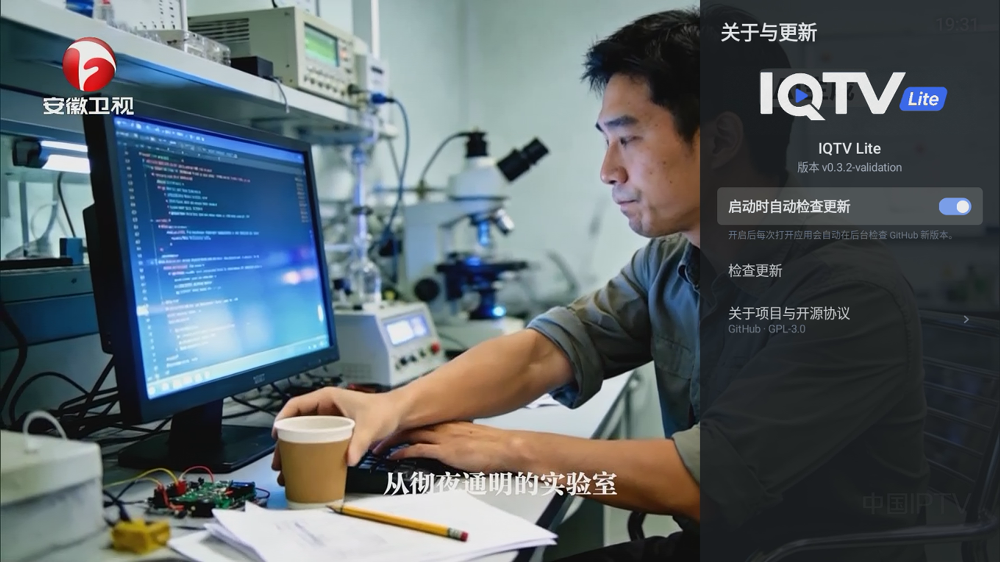

<div align="center">
  <picture>
    <source media="(prefers-color-scheme: dark)" srcset="assets/logo-white-transparent.png" />
    <source media="(prefers-color-scheme: light)" srcset="assets/logo-transparent.png" />
    
  </picture>

  <p><strong>专为 Android TV 与电视盒子打造的轻量、纯净直播电视播放器</strong></p>
  <p><em>A clean, lightweight, open-source D-pad IPTV player for Android TV and TV boxes</em></p>

  <p>
    <a href="LICENSE"></a>
    <a href="https://github.com/zqs1qiwan/iqtvlite/releases/latest"></a>
    
    
  </p>

  <p>
    <a href="#为什么选择-iqtv-lite">产品亮点</a> ·
    <a href="#界面预览">界面预览</a> ·
    <a href="#使用功能指南">功能指南</a> ·
    <a href="#播放列表与请求头配置">播放列表与 Header</a> ·
    <a href="#高级与实验选项">高级选项</a> ·
    <a href="#安装与更新">安装与更新</a> ·
    <a href="#遥控器按键说明">遥控器操作</a> ·
    <a href="#english-documentation">English Documentation</a>
  </p>
</div>

---

## 为什么选择 IQTV Lite

- **免费开源，纯净无广告**：多播放列表切换、EPG 节目单、回看、自定义遥控按键、手机扫码管理、配置备份恢复及内置更新全部免费开放，没有任何广告或付费限制。
- **专为电视盒子优化的流畅体验**：支持硬件加速解码（含 4K H.265 / HEVC），换台响应迅速；即使在入门级电视盒子上管理上千个频道与长节目单，翻页与换台依然顺滑跟手。
- **复杂直播源开箱即用**：内置对防盗链 `Referer` / `User-Agent` / `Cookie` 等请求头的支持，支持同频道多条备用线路自动容灾与手动切换，并精准区分 4K 与普通高清频道。

---

## 界面预览

<table>
  <tr>
    <td width="50%" align="center">
      
      <br />
      <sub><b>底部信息栏与快捷控制</b>：显示当前频道台标、名称、节目进度与画质参数；向下或再按一次确认键即可展开最近观看列表及收藏、换源、画面比例、音轨、字幕、多画面与设置入口。</sub>
    </td>
    <td width="50%" align="center">
      
      <br />
      <sub><b>频道列表与节目单</b>：直观展示台标与正在播出的节目，右侧同步列出多日节目预告；选中带有回看标识的历史节目可直接点播回看。</sub>
    </td>
  </tr>
  <tr>
    <td width="50%" align="center">
      
      <br />
      <sub><b>频道分组与多源切换</b>：在选台列表按左键可切换不同频道分组与收藏夹，接入多个播放源时可继续向左快速切换列表。</sub>
    </td>
    <td width="50%" align="center">
      
      <br />
      <sub><b>分类设置中心</b>：包含通用、节目列表、节目预告、外观、播放解码、遥控设置、关于与更新七大板块，所有功能均可使用电视遥控器直接设置。</sub>
    </td>
  </tr>
  <tr>
    <td width="50%" align="center">
      
      <br />
      <sub><b>手机扫码配置</b>：在设置内打开二维码并用手机浏览器扫码，即可直接输入订阅链接、批量设置请求头、自定义按键映射以及导出或恢复配置备份。</sub>
    </td>
    <td width="50%" align="center">
      
      <br />
      <sub><b>关于与在线更新</b>：查看当前软件版本，支持一键检查并下载安装最新版本，保持播放器持续更新。</sub>
    </td>
  </tr>
</table>

---

## 使用功能指南

- **智能频道信息栏与快捷栏**：
  - 上下切换频道时，屏幕底部会短暂显示频道信息与当前/下一档节目；可在「外观」中设置信息栏停留时长或开启右上角实时时间显示。
  - 按 `OK` 键呼出控制台：两段式模式下先显示频道信息与底部箭头提示，按 `↓` 或再按一次 `OK` 即可展开 **最近观看的 5 个频道** 与快捷操作栏（**收藏 · 换源 · 画面比例 · 音轨 · 字幕 · 多画面 · 设置**）；习惯直接展开的用户也可在「外观」中调整。
- **分栏选台与节目回看**：
  - 按 `←` 键打开左侧频道列表与右侧节目单，选中不同频道即可浏览未来与历史节目；支持按「默认 / 名称 / 手动」顺序整理分组，以及显示或隐藏「全部频道」和「收藏夹」。
  - 再次点击当前正在播放的频道会直接收起菜单回到全屏观看；若已添加多个订阅源，继续按 `←` 即可快速切换播放源。
- **多线路容灾与手动换源**：
  - 当一个频道配有多个播放地址时，快捷栏会显示当前线路编号（如 `线路 1/3`），可随时手动切换清晰度或备用源；若当前线路连接异常，播放器会自动尝试下一条可用线路。
- **数字直达选台与画质增强**：
  - 使用遥控器数字键输入频道号，屏幕右上角会实时列出匹配频道，稍候或按确认即可跳转。
  - 支持硬件视频解码优先调度（包含 4K H.265 流畅硬解）及多语言字幕自动匹配。
- **应用内多画面同屏**：
  - 在 `OK` 快捷栏点击「多画面」，可在当前画面旁再开启一个小窗同时观看另一个频道；按 `→` 键可快速互换主副画面，双击返回即可退出多画面。
- **手机扫码免打字配置与配置备份**：
  - 在电视端「设置」内扫码进入手机网页后台，无需用遥控器输入复杂网址即可添加 M3U / EPG 订阅、全局请求头、微调播放参数，并可一键导出或导入 **JSON 完整配置备份**。

---

## 播放列表与请求头配置

### 1. 同台多线路 vs 独立频道
- **同一频道聚合多条线路**（在一个 `#EXTINF` 信息行下方连续放置多个地址，播放器会自动合并为 `线路 1/N` 供切换与自动容错）：
```m3u
#EXTINF:-1 tvg-id="dongfangweishi" tvg-name="东方卫视" tvg-logo="https://example.com/logo/dragontv.png" http-user-agent="VLC" group-title="卫视频道",东方卫视
http://example.com/line1.m3u8|User-Agent=VLC
http://example.com/line2.m3u8|User-Agent="CustomPlayer/1.1"
http://example.com/line3.m3u8
```
- **保留独立频道**（各自使用独立的 `#EXTINF` 行，即使拥有相同的台标或 `tvg-id`，如 `4K` 与高清频道也会分开显示）：
```m3u
#EXTINF:-1 tvg-id="beijingweishi" group-title="卫视频道",北京卫视4K
https://example.com/btv4k.m3u8|Referer=https://api.example.com/
#EXTINF:-1 tvg-id="beijingweishi" group-title="卫视频道",北京卫视
http://example.com/btvhd.m3u8|User-Agent=VLC
```

### 2. 自定义 HTTP 请求头（Header）
当多处均配置了请求头时，生效优先级为：**单条地址后缀 `|` 参数 > `#EXTINF / #EXTVLCOPT` 行内参数 > 设置中的全局 Header**。

- **方式 A：地址末尾用 `|` 附加参数**（多个字段用 `&` 或 `;` 分隔，含空格的值可用引号括起）：
```text
https://example.com/live.m3u8|User-Agent=VLC&Referer=https://example.com/&Origin=https://example.com&Cookie=sid=123
```
- **方式 B：写在 `#EXTINF` 或 `#EXTVLCOPT:` 中**：
```m3u
#EXTINF:-1 http-user-agent="VLC" http-referer="https://example.com/" http-origin="https://example.com",示例频道
http://example.com/stream.m3u8
```
- **方式 C：在「设置 → 通用」或手机扫码网页端配置全局 User-Agent 与全局 Header（每行一条）**：
```text
Referer: https://example.com/
Origin: https://example.com
X-Custom-Token: your-token
```

---

## 高级与实验选项

在「设置 → 播放解码 → 高级优化（实验）」中提供了以下进阶调节项，适合针对特定设备或特殊网络环境优化体验：

| 选项名称 | 默认状态 | 功能说明 | 使用建议 |
| --- | --- | --- | --- |
| **4K 切台防花屏重建** | 开启 | 切换到 4K 超高清频道时自动重置视频解码器，避免部分老旧机顶盒在切换高分辨率画面时出现绿屏或花屏。 | 仅在确认当前设备切换 4K 永不花屏且追求极致切台速度时关闭。 |
| **预连接相邻频道** | 关闭 | 观看当前频道时在后台提前建立上/下一台的连接，缩短连续按上下键换台的等待时间。 | 若所用直播源对同一 IP 或 Token 的同时连接数有限制，请保持关闭。 |
| **组播预热** | 关闭 | 针对家庭宽带 IPTV 组播源（`udp://` / `rtp://`）提前加入相邻组播流以加速内网换台。 | 普通公网 HTTP/HLS 直播源请保持关闭。 |
| **码流兼容模式** | 关闭 | 针对部分时间戳异常、容易只出声不出画或音画逐渐漂移的特殊频道提供兼容播放模式。 | 仅在个别频道播放异常时按需尝试，日常观看保持关闭即可。 |

---

## 安装与更新

1. 前往 [**Releases 最新版本**](https://github.com/zqs1qiwan/iqtvlite/releases/latest) 下载 `IQTV-Lite-v0.2.3.apk`（或通用最新包 `IQTV-Lite-latest.apk`）。
2. 将安装包传至 Android TV 或电视盒子安装（支持 Android 7.0 及以上系统，兼容 32 位与 64 位设备）。
3. 之后可在电视端进入「设置 → 关于与更新 → 检查更新」，直接在应用内下载安装新版。

---

## 遥控器按键说明

| 按键 | 默认功能 |
| --- | --- |
| `↑` / `↓` | 切换上 / 下一个频道，并在底部弹出当前频道与节目信息 |
| `OK` / `确认` | 呼出控制台（两段式下先显示台标与节目，按 `↓` 或再次按 `OK` 展开最近观看与快捷操作栏；点击最右侧齿轮进入设置） |
| `←` | 逐级打开选台抽屉：**频道与节目单 → 分组 → 播放源** |
| `→` | 默认**一键返回上一频道**（在多画面模式下用于互换主副画面，也可在设置中改作打开设置等其他功能） |
| `Back / 返回` | 关闭菜单或逐级退回；全屏播放时默认连按两次返回退出应用 |
| `数字键 0–9` | 输入频道号快速选台，右上角同步提示匹配频道列表 |

> 以上短按与长按功能均可在「设置 → 遥控设置」或手机网页端按个人习惯自由修改。

---

# English Documentation

<div align="center">
  <p>
    <a href="#why-iqtv-lite">Highlights</a> ·
    <a href="#screenshots">Screenshots</a> ·
    <a href="#feature-guide">Feature Guide</a> ·
    <a href="#playlist--custom-http-headers">Playlist & Headers</a> ·
    <a href="#advanced--experimental-options">Advanced Options</a> ·
    <a href="#installation--updates">Installation & Updates</a> ·
    <a href="#remote-control-guide">Remote Control</a> ·
    <a href="#license">License</a>
  </p>
</div>

## Why IQTV Lite

- **Free, Open Source & Ad-Free (GPLv3)**: Multi-playlist support, XMLTV EPG, catch-up playback, full D-pad remapping, mobile QR configuration, JSON backup/restore, and built-in app updates are all completely free with zero ads or paywalls.
- **Fast & Smooth on Living-Room TVs**: Optimized for Android TV and entry-level TV boxes with hardware-accelerated decoding (including smooth 4K H.265 playback) and responsive navigation even with thousands of channels and multi-day program guides.
- **Ready for Complex Streams**: Works out of the box with custom `Referer` / `User-Agent` / `Cookie` headers, automatic multi-line failover and manual source switching, plus clean separation between 4K and HD channels.

## Screenshots

<table>
  <tr>
    <td width="50%" align="center">
      
      <br />
      <sub><b>Bottom Info Bar & Quick Controls</b>: Displays channel logo, live/next program progress, and stream badges. Press ↓ or OK again to reveal recently watched channels along with Favorite, Source, Aspect Ratio, Audio, Subtitles, Multi-Screen, and Settings shortcuts.</sub>
    </td>
    <td width="50%" align="center">
      
      <br />
      <sub><b>Channel List & EPG Guide</b>: Browse channels with logos and live progress alongside a multi-day program schedule; select any past program marked for catch-up to replay it directly.</sub>
    </td>
  </tr>
  <tr>
    <td width="50%" align="center">
      
      <br />
      <sub><b>Groups & Multi-Source Switcher</b>: Press ← inside the channel list to jump between groups or Favorites, and press ← again when multiple playlists are enabled to switch sources seamlessly.</sub>
    </td>
    <td width="50%" align="center">
      
      <br />
      <sub><b>Organized TV Settings</b>: Seven clear sections—General, Playlists, EPG, Appearance, Playback, Remote, and About & Updates—designed for comfortable remote-control navigation.</sub>
    </td>
  </tr>
  <tr>
    <td width="50%" align="center">
      
      <br />
      <sub><b>Scan-to-Configure from Phone</b>: Open the built-in QR code in Settings and scan it from your phone browser to paste playlist/EPG URLs, edit custom headers, remap keys, or export/restore full JSON backups without typing on the TV.</sub>
    </td>
    <td width="50%" align="center">
      
      <br />
      <sub><b>About & In-App Updates</b>: View installed version details and check for, download, and install new releases directly on your TV.</sub>
    </td>
  </tr>
</table>

## Feature Guide

- **Clean Info Console & Quick Actions (`OK`)**:
  - Changing channels briefly shows the channel logo, live/next program, and stream specs at the bottom; banner duration and the optional top-right clock can be customized in **Appearance**.
  - Press `OK` for the info console: in two-step mode, the first press shows channel details with a subtle bottom arrow cue, and pressing `↓` or `OK` again reveals **5 recently watched channels** plus quick actions (**Favorite · Source · Aspect Ratio · Audio · Subtitles · Multi-Screen · Settings**). You can also switch to one-step direct expansion in Appearance settings.
- **Sidebar Channel & EPG Browser (`←`)**:
  - Press `←` to browse channels alongside the multi-day program guide and catch-up playback. Sort groups by Default, Name, or Manual order, and toggle visibility for *All* and *Favorites*.
  - Clicking the currently playing channel closes the drawer back to fullscreen; if multiple playlists are active, pressing `←` again lets you switch playlists.
- **Multi-Line Switching & Automatic Failover**:
  - Channels with multiple stream URLs display the active line (`Src 1/N`) in the `OK` quick bar so you can manually pick the best feed, while playback errors automatically fail over to healthy backup lines.
- **Top-Right Numeric Jump & 4K Hardware Acceleration**:
  - Enter digits (`0–9`) on the remote to filter matching channels in a compact top-right overlay without covering the video.
  - Prioritizes hardware decoding (including 4K HEVC support) and supports automatic subtitle loading with preferred language selection.
- **In-App Dual Multi-Screen Viewing**:
  - Choose **Multi-Screen** in the `OK` quick bar to watch a second channel side-by-side in an overlay window (`→` swaps the main and secondary feeds; double-press `Back` to close).
- **Phone QR WebUI & Backup/Restore**:
  - Scan the QR code inside Settings from any phone on the same Wi-Fi/LAN to manage playlists, global HTTP headers, playback preferences, remote mappings, and **JSON configuration backup & restore**.

## Playlist & Custom HTTP Headers

### 1. Multi-Line Aggregation vs Independent Channels
- **Multiple backup URLs for one channel** (place multiple URLs under one `#EXTINF` block to combine them into `Src 1/N` with failover):
```m3u
#EXTINF:-1 tvg-id="dragontv" tvg-name="Dragon TV" tvg-logo="https://example.com/logo/dragontv.png" http-user-agent="VLC" group-title="Satellite",Dragon TV
http://example.com/line1.m3u8|User-Agent=VLC
http://example.com/line2.m3u8|User-Agent="CustomPlayer/1.1"
http://example.com/line3.m3u8
```
- **Independent channels** (give each stream its own `#EXTINF` entry so 4K and HD channels appear separately even with the same `tvg-id`):
```m3u
#EXTINF:-1 tvg-id="btv" group-title="Satellite",BTV 4K
https://example.com/btv4k.m3u8|Referer=https://api.example.com/
#EXTINF:-1 tvg-id="btv" group-title="Satellite",BTV HD
http://example.com/btvhd.m3u8|User-Agent=VLC
```

### 2. Custom HTTP Headers & Priority
When headers are specified in multiple places, priority is: **`URL | params` > `#EXTINF / #EXTVLCOPT` > `Global Headers (Settings / WebUI)`**.

- **Method A — Append `|` parameters to a stream URL** (separate multiple headers with `&` or `;`; quoted values supported):
```text
https://example.com/live.m3u8|User-Agent=VLC&Referer=https://example.com/&Origin=https://example.com&Cookie=sid=123
```
- **Method B — `#EXTINF` attributes or `#EXTVLCOPT:` directives**:
```m3u
#EXTINF:-1 http-user-agent="VLC" http-referer="https://example.com/" http-origin="https://example.com",Sample Channel
http://example.com/stream.m3u8
```
- **Method C — Global User-Agent & Custom Headers** (configured in **Settings → General** or the Phone WebUI, one per line):
```text
Referer: https://example.com/
Origin: https://example.com
X-Custom-Token: your-token
```

## Advanced & Experimental Options

Under **Settings → Playback → Advanced (Experimental)**, optional tuning switches are provided for specific hardware or network setups:

| Option | Default | What It Does | When to Adjust |
| --- | --- | --- | --- |
| **4K Zap Anti-Artifacting Rebuild** | ON | Resets the hardware video decoder when tuning to 4K UHD channels to prevent green frames or visual artifacts on older TV boxes. | Turn OFF only if your device never shows 4K artifacts and you prefer slightly faster 4K channel switching. |
| **Neighbour Preconnect** | OFF | Pre-connects to the adjacent (`±1`) channels while idle to reduce channel-switch wait times. | Keep OFF if your IPTV provider restricts concurrent connections per IP or token. |
| **Multicast Prewarm** | OFF | Pre-joins adjacent home ISP IPTV multicast groups (`udp://` / `rtp://`) for faster LAN switching. | Only enable for local multicast IPTV; keep OFF for standard HTTP/HLS streams. |
| **Stream Compatibility** | OFF | Alternative compatibility modes for unusual broadcast feeds that freeze, lose A/V sync, or play audio without video. | Leave OFF for normal channels; test only if a specific stream fails to play smoothly. |

## Installation & Updates

1. Download `IQTV-Lite-v0.2.3.apk` (or `IQTV-Lite-latest.apk`) from [**Latest Release**](https://github.com/zqs1qiwan/iqtvlite/releases/latest).
2. Install it on your Android TV or TV box (`Android 7.0+`, compatible with both `arm64-v8a` and `armeabi-v7a` devices).
3. Update anytime from **Settings → About & Updates → Check for Updates**, or download manually from GitHub Releases.

## Remote Control Guide

| Key | Default Action |
| --- | --- |
| `↑` / `↓` | Switch to previous / next channel and briefly show the info bar |
| `OK` / `Enter` | Open info console (two-step shows channel info first; press `↓` or `OK` again for recent channels and quick controls including `Src 1/N` and Settings) |
| `←` | Open sidebar browser step by step: **Channels & EPG → Groups → Sources** |
| `→` | **Previous Channel** by default (swaps main & secondary screens during Multi-Screen; customizable in Settings) |
| `Back` | Close menus step by step; press `Back` twice during fullscreen playback to exit |
| `0–9` | Jump directly by channel number via the top-right match list |

> Both short-press and long-press actions can be customized freely in **Settings → Remote** or through the Phone WebUI.

---

## License · 开源许可

This project is free software licensed under the [**GNU General Public License v3.0 (GPLv3)**](LICENSE).
本项目基于 [**GNU General Public License v3.0 (GPLv3)**](LICENSE) 开源发布。
