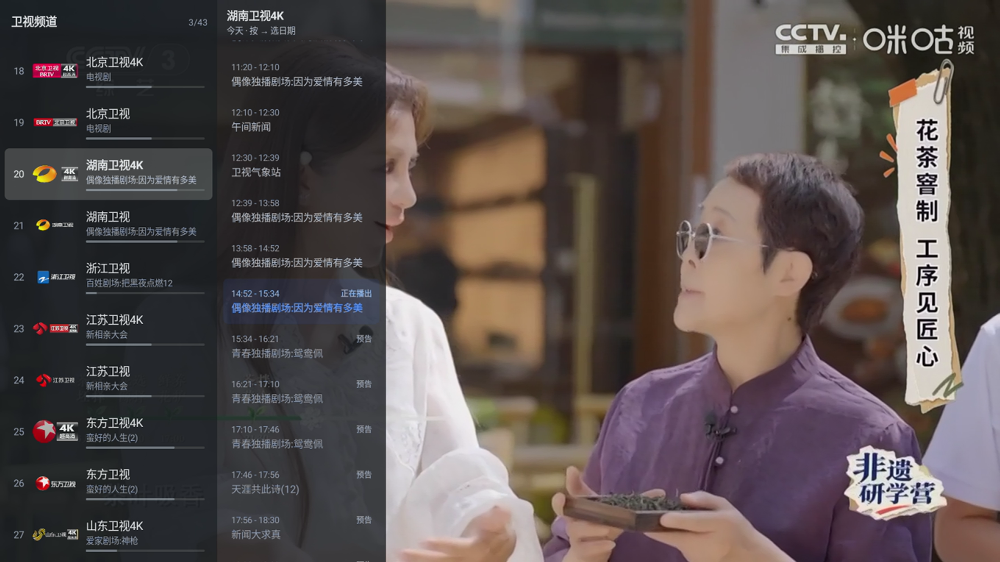
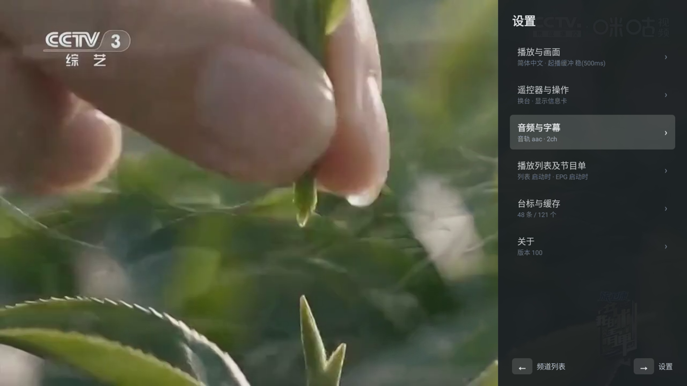
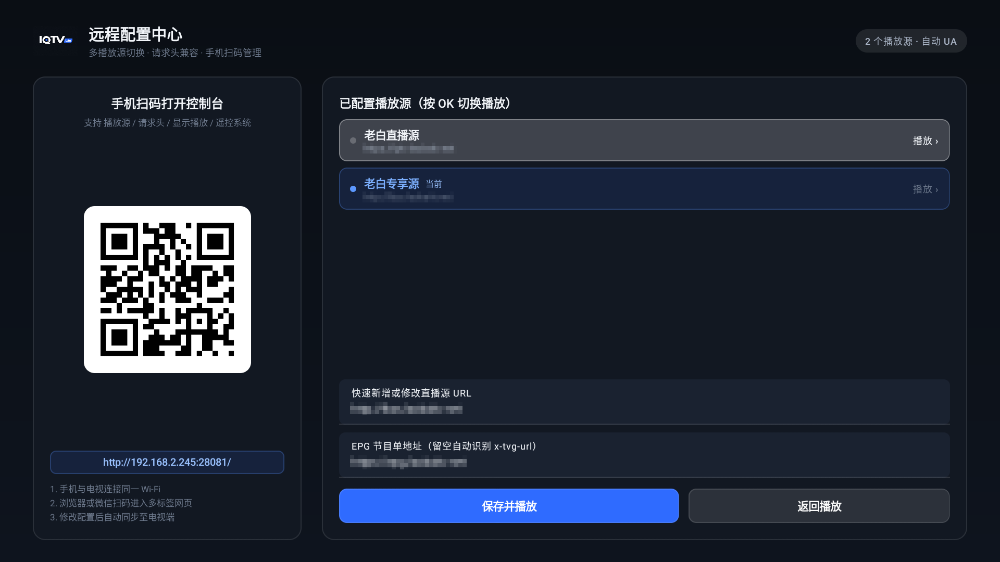

  <picture>
    <source media="(prefers-color-scheme: dark)" srcset="assets/logo-white-transparent.png" />
    <source media="(prefers-color-scheme: light)" srcset="assets/logo-transparent.png" />
    
  </picture>

  
<strong>专为 Android TV 与电视盒子打造的轻量、纯净、高响应直播电视播放器</strong>

  
<em>A clean, fast, D-pad-first IPTV player built for Android TV and TV boxes</em>

  

    
    
    
    
  

  

    <a href="#界面展示">界面展示</a> ·
    <a href="#核心功能">核心功能</a> ·
    <a href="#安装与更新">安装与更新</a> ·
    <a href="#遥控器操作指南">遥控器操作</a> ·
    <a href="#english-overview">English</a>
  

---

## 界面展示

<table>
  <tr>
    <td width="50%" align="center">
      
       
      <b>信息卡与最近观看</b>：实时分辨率 / 帧率 / 编码徽标、当前节目进度条与 5 个最近观看频道一键切换
    </td>
    <td width="50%" align="center">
      
       
      <b>频道列表与 EPG 节目单</b>：台标展示、正在播出高亮进度、多日节目预告，4K 与高清频道独立显示
    </td>
  </tr>
  <tr>
    <td width="50%" align="center">
      
       
      <b>逐级抽屉与多源切换</b>：按左键依次展开「频道」「分组」「播放源」，视野清爽不遮挡画面
    </td>
    <td width="50%" align="center">
      
       
      <b>大屏设置中心</b>：支持中英文实时切换、大/中/小界面缩放、按键自定义、多源管理与在线检查更新
    </td>
  </tr>
  <tr>
    <td colspan="2" align="center">
      
       
      <b>手机扫码多源控制台</b>：同一局域网下手机扫码或浏览器访问，免遥控器输入直接管理多源、请求头与播放偏好
    </td>
  </tr>
</table>

---

## 核心功能

- **电视遥控器优先体验**：上下键即按即切台，信息卡在换台或主动呼出后都会按各自时长自动收起，专注看电视不被打扰。
- **逐级展开选台抽屉**：
  - 按 `←` 打开 **频道 + 节目单**，聚焦长节目名自动平滑滚动。
  - 再按一次 `←` 自动收起节目单，展示 **分组 + 频道**。
  - 若启用了多个播放源，继续按 `←` 展开最左侧 **播放源** 列表快速切换。
- **多播放源与灵活兼容性**：
  - 支持同时添加多个 M3U / M3U8 直播源与 XMLTV 节目单地址，可设置启用/隐藏与在抽屉中快捷切换。
  - 原生支持 `|User-Agent=`、`http-user-agent`、`http-referer`、`#EXTVLCOPT` 等常见播放参数识别，并可在设置或网页端配置全局 User-Agent 与自定义 Header。
  - 智能区分 `4K` / `8K` 等超高清版本与标准清晰度频道，避免不同画质版本被误合并。
- **手机扫码远程配置（中英双语网页端）**：
  - 首次打开可自动进入手机扫码配置页，支持标签页管理「播放源与请求头」「显示与播放」「更新设置」「遥控按键」。
- **双语界面与大屏可读性调节**：
  - 首次启动主动选择 **简体中文** 或 **English**，后续可随时在「设置 → 播放与画面 → 语言 / Language」切换，网页端右上角亦可一键切换。
  - 提供 **小 / 中 / 大** 三档文字与台标展示尺寸，兼顾近距离显示器与客厅大尺寸电视。

---

## 安装与更新

1. 前往 [**Releases 最新版本**](https://github.com/zqs1qiwan/iqtvlite/releases/latest) 下载 `IQTV-Lite-v0.1.0.apk`（或通用最新包 `IQTV-Lite-latest.apk`）。
2. 将 APK 传至 Android TV / 电视盒子安装（支持系统 7.0 及以上，兼容 32 位与 64 位 ARM 电视芯片）。
3. 后续可在电视端「设置 → 关于 → 检查更新」直接检测并跳转安装新版本。

---

## 遥控器操作指南

| 按键 | 功能说明 |
| --- | --- |
| `↑` / `↓` | 切换上 / 下一个频道（自动弹出简短信息卡并收起） |
| `OK` / `Enter` | 呼出底部信息卡与最近观看列表（再次按 `OK` 进入快捷切台） |
| `←` | 逐级打开选台抽屉：**频道 + 节目单 → 分组 → 播放源** |
| `→` / `Menu` | 打开右侧电视设置菜单 |
| `Back` | 逐级退回或关闭菜单；在播放器全屏状态可按设置好的快捷键退出 |
| `数字键` | 直接输入频道号跳转 |

> 以上短按与长按行为均可在「设置 → 遥控器与操作」或手机网页端按个人习惯自由改键或置空。

---

## English Overview

**IQTV Lite** is a lightweight, responsive live TV player tailored for Android TV remote controls.

- **Clean Progressive Navigation**: Press `←` to open **Channels + EPG**, press `←` again to collapse EPG into **Groups**, and press `←` once more to reveal **Playlist Sources** when multiple sources are enabled.
- **Smart Info Banner**: Auto-hides briefly on channel zapping or stays visible slightly longer when opened with `OK`, displaying live video stats (`HD / 4K`, `fps`, audio layout, `SDR / HDR`, codec), EPG progress, and 5 quick-switch recent channels.
- **Multi-Source & Compatibility**: Supports multiple M3U/XMLTV playlists, inline `|User-Agent=` / `|Referer=` / `#EXTINF` / `#KODIPROP` headers, global User-Agent & custom HTTP headers, and preserves separate `4K` / `8K` vs HD channel entries while matching EPG across both.
- **Scan-to-Configure Web Console**: Scan the on-TV QR code from your phone or PC browser to edit playlists, headers, display scale (`Small` / `Medium` / `Large`), UI language (`简体中文` / `English`), and remote key bindings.
- **Install**: Download the signed APK from [**Latest Release**](https://github.com/zqs1qiwan/iqtvlite/releases/latest) (`Android TV 7.0+`, `arm64-v8a` & `armeabi-v7a`).

---

## 开源许可 · License

本项目基于 [**GNU General Public License v3.0 (GPLv3)**](LICENSE) 开源发布。
This project is free software licensed under the [GNU General Public License v3.0](LICENSE).
