

  

    <picture>
      <source media="(prefers-color-scheme: dark)" srcset="assets/logo-white-transparent.png" />
      <source media="(prefers-color-scheme: light)" srcset="assets/logo-transparent.png" />
      
    </picture> 
    <strong>专为 Android TV 与电视盒子打造的轻量、纯净、极速换台直播电视播放器</strong> 
    遥控器优先 · 4K HEVC/HDR 硬解优先 · 原生直连 RTP/UDP 组播 · 家庭局域网免密 WebUI
  

  

    
    
    
    
    
    
  

  

    <a href="README.md">English</a> ·
    <b>简体中文</b> ·
    <a href="https://zqs1qiwan.github.io/iqtvlite/#zh/home">📖 在线主页与使用文档 (Wiki)</a>
  

---

**IQTV Lite** 是一款面向电视与机顶盒的原生 **Android TV** 开源播放器，基于 Jetpack Compose for TV、Media3 ExoPlayer 与 Rust 核心库（`iqtvlite-capi`）构建，兼顾 **512MB–1GB 入门老盒子** 的低占用流畅度与 **4K HDR / 家庭组播** 的高品质观影体验。

> ⚠️ **纯播放器声明：** IQTV Lite 不内置任何电视频道、直播源或订阅链接，请自行导入合法的 M3U / TXT 直播源与 XMLTV 节目单。

> ### 📖 完整教程：**[前往项目首页与交互式 Wiki →](https://zqs1qiwan.github.io/iqtvlite/#zh/home)**
> 收录图文界面导览、组播与 Header 配置规则、AFR/音频调校、DoH、EPG 时区纠偏与常见问题排查（支持站内搜索）。

---

## ✨ 核心特性

### 🎬 播放、解码与画面体验
- **硬解优先梯队 + 单频道解码记忆**：默认所有频道优先调度 `MediaCodec` 硬解（针对老旧盒子的 4K HEVC/HDR 异常做专门纠偏），异常时逐级回退并切台自动恢复；还支持在菜单为单个特殊频道记住「强制硬解 / 强制软解」。
- **自动帧率匹配（AFR）**：在流帧率稳定 **1,200 ms** 后匹配最接近刷新率（如 `25fps → 50Hz`、`23.976`、`59.94Hz`），防快速换台黑屏闪烁，绝不擅自降低分辨率。
- **4K 切台防花屏**：可选在切换超高清频道时重置解码器，消除旧款盒子切台绿屏与花屏。
- **纯音频收听模式 &amp; 双画面多屏同看**：底部快捷栏一键「仅听音频」（熄画听广电/新闻省电防烧屏）；支持同屏双台画中画，`→` 键秒速互换主副画面。

### 🔊 音频路由延迟与人声增强
- **分设备音画延迟微调（`±500 ms`）**：按 **本机扬声器 / 蓝牙音频 / HDMI 功放** 分别独立记忆延迟数值，解决蓝牙/Soundbar 声画不同步。
- **最高 150% 响度增益**：零第三方依赖的软限幅 PCM 增益算法（`100%–150%`），未开启增益与延迟时处理器完全旁路（`0 CPU / 0 堆分配`）。

### 🌐 网络协议栈、DoH 与 EPG
- **原生直连 `rtp://` / `udp://` 组播引擎**：内置非阻塞接收线程 + **4 MB 环形缓冲区** + 动态 `WifiLock`/`MulticastLock`，直连运营商组播流且全面兼容 HTTP/udpxy 单播。
- **IPv6 / IPv4 双栈优先级**：默认优先 IPv6 并支持失败自动无缝回退 IPv4（可在设置或手机 Web 端切换为 IPv4 优先）。
- **零外部依赖加密 DNS（DoH）**：内置 **系统默认（默认）**、**阿里 DoH（`223.5.5.5`）**、**腾讯 DoH（`doh.pub`）** 与 **Cloudflare DoH（`1.1.1.1`）**，带 256 条 TTL 缓存、局域网/IP 自动跳过与系统 DNS 兜底回退。
- **SQLite EPG 索引 + `±12h` 时区偏移**：XMLTV 后台写入本地索引库实现毫秒换台查表，支持无需重新拉取或修改数据库的实时 `±12 小时` 时区纠偏。

### 📱 手机 WebUI 与诊断导出
- **家庭局域网免密扫码后台**：手机扫码即可管理多播放源、调整抽屉展示、全局请求头、DoH / 网络栈、EPG 偏移，并一键导出/还原 **JSON 完整配置备份**。
- **实时码流诊断与日志下载**：电视端可在设置内查看实时解码器、分辨率/帧率、AFR、音频路由、DoH 命中与 **RTP 丢包率**；手机端支持点击「导出播放诊断日志」（`GET /api/diag`）直接保存排查。

---

## 🖼️ 实机界面预览

<table>
  <tr>
    <td width="50%" align="center">
      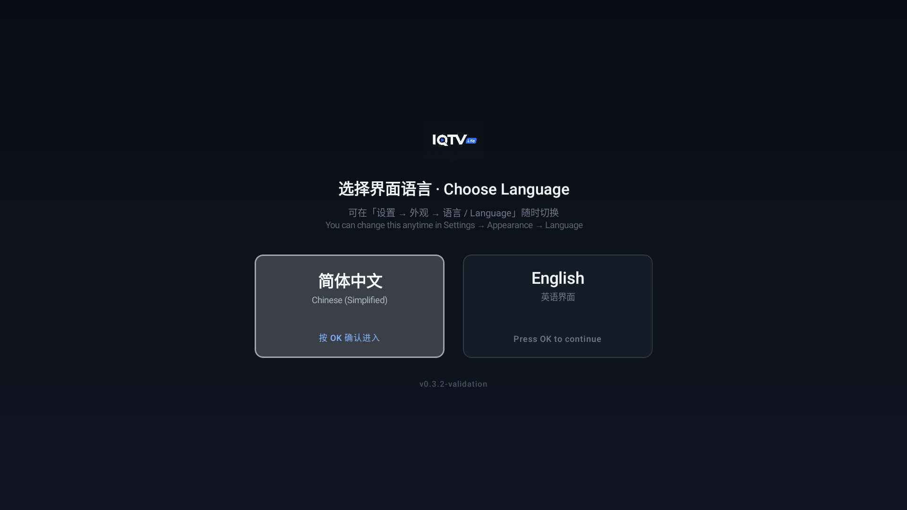
       
      <b>首次开机第 1 步 · 简体中文 / English 语言选择</b>
    </td>
    <td width="50%" align="center">
      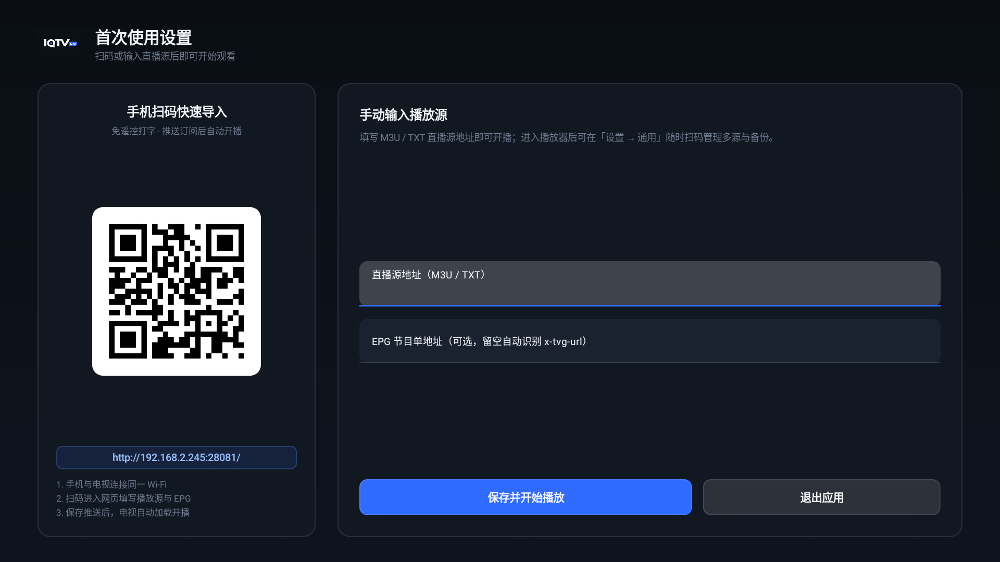
       
      <b>首次开机第 2 步 · 手机扫码或手动输入直播源</b>
    </td>
  </tr>
  <tr>
    <td width="50%" align="center">
      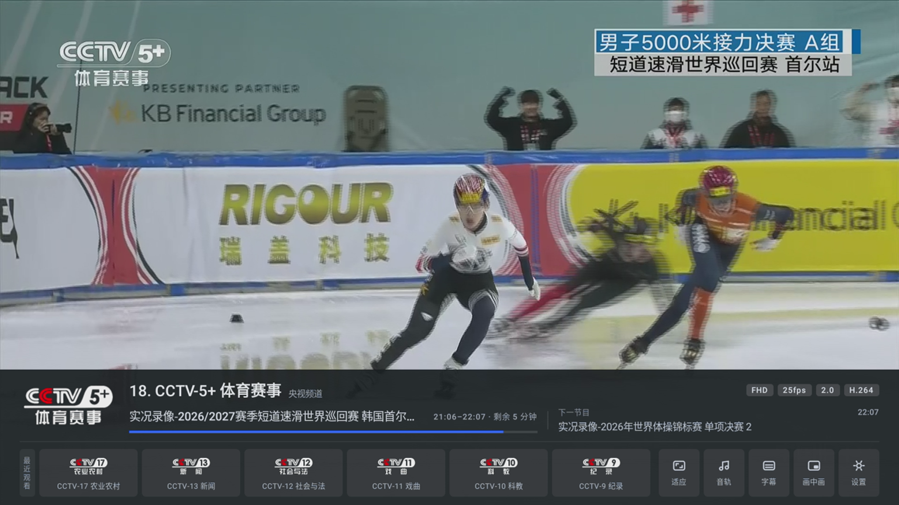
       
      <b>两段式底部信息栏 · 最近观看与快捷控制</b>
    </td>
    <td width="50%" align="center">
      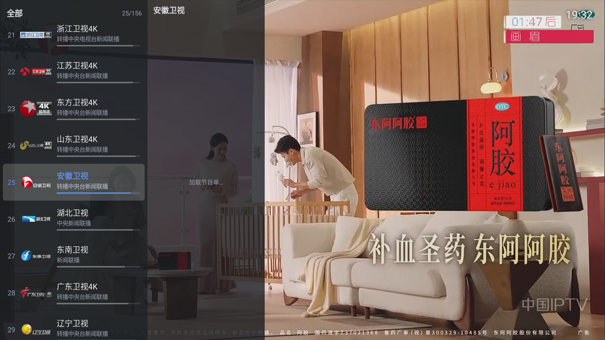
       
      <b>左侧分栏选台与 EPG 节目单</b>
    </td>
  </tr>
  <tr>
    <td width="50%" align="center">
      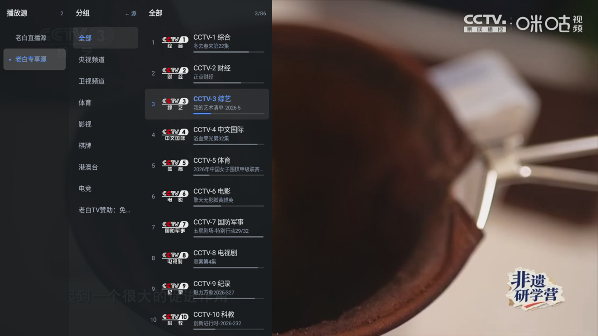
       
      <b>分组整理与多播放源快速切换</b>
    </td>
    <td width="50%" align="center">
      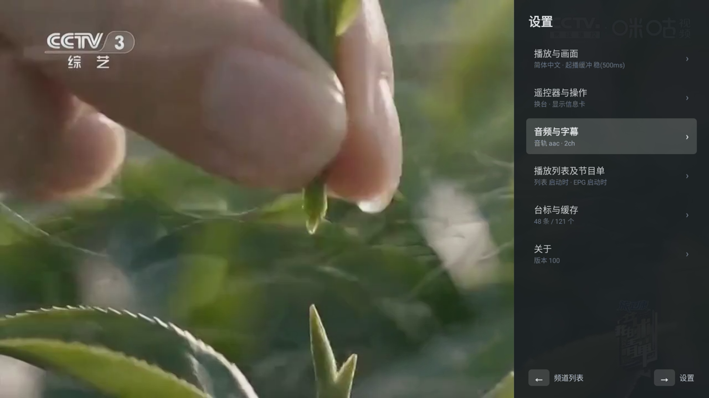
       
      <b>7 大分类设置中心首页</b>
    </td>
  </tr>
  <tr>
    <td width="50%" align="center">
      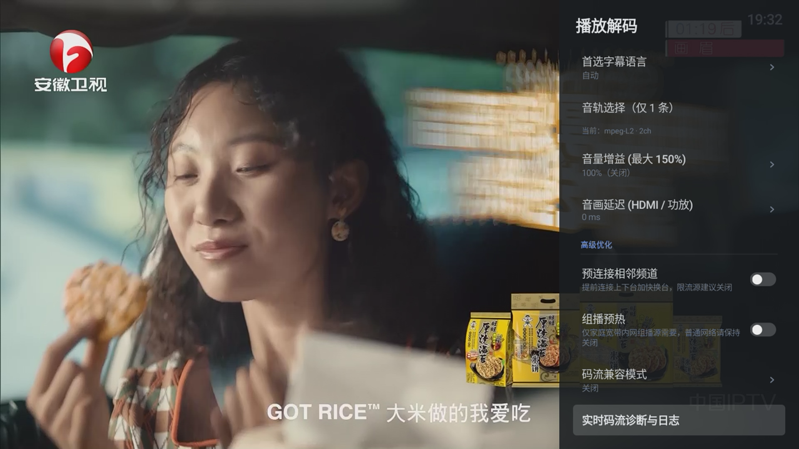
       
      <b>播放与解码 · 单频道覆盖、AFR 与音频 DSP</b>
    </td>
    <td width="50%" align="center">
      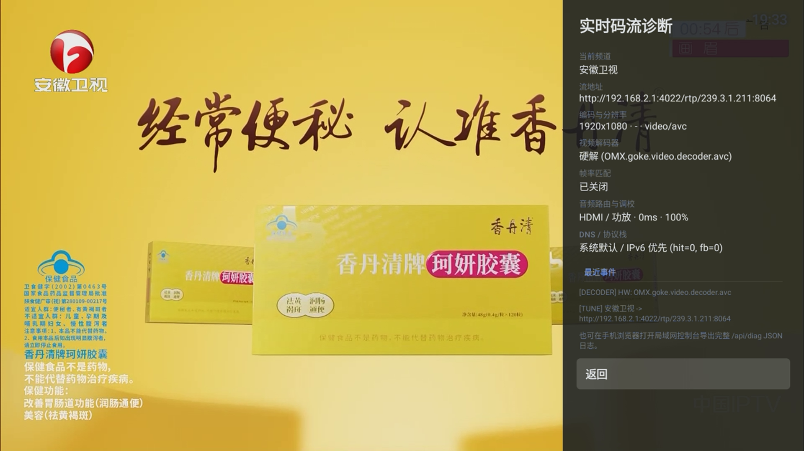
       
      <b>实时码流诊断视图</b>
    </td>
  </tr>
  <tr>
    <td width="50%" align="center">
      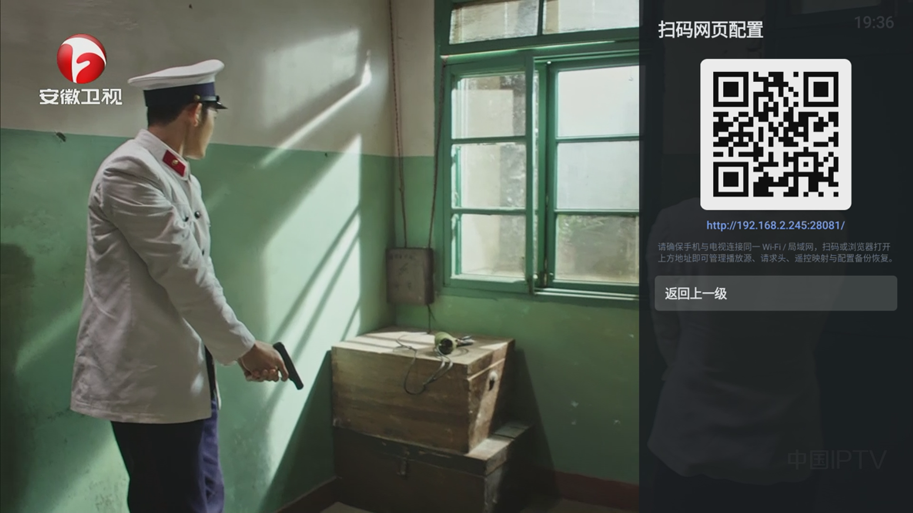
       
      <b>手机扫码免密配置与 JSON 备份</b>
    </td>
    <td width="50%" align="center">
      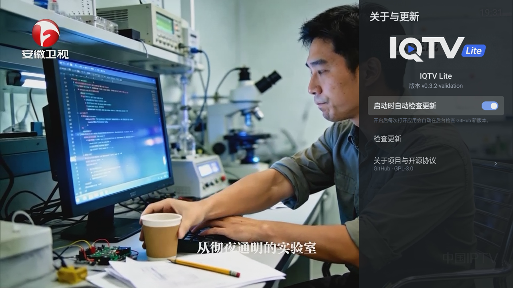
       
      <b>关于与内置在线检查更新</b>
    </td>
  </tr>
</table>

---

## 📦 安装与快速开始

1. 直接下载 [**`IQTV-Lite-latest.apk`**](https://github.com/zqs1qiwan/iqtvlite/releases/latest/download/IQTV-Lite-latest.apk) 或前往 [**GitHub Releases 最新版本**](https://github.com/zqs1qiwan/iqtvlite/releases/latest) 下载（约 8.7 MB，单包兼容 `arm64-v8a` 与 `armeabi-v7a`，支持 Android 7.0+）。
2. 通过 U 盘安装到电视/盒子，或执行 `adb install -r IQTV-Lite-latest.apk`。
3. **首次开机两步向导**：首次启动先选择界面语言（**简体中文 / English**），随后进入极简 **「首次使用设置」** 引导页——同一 Wi-Fi 下手机扫码推送直播源后电视将**自动加载开播**，也可直接在右侧手动填写 **直播源地址（M3U / TXT）** 与 **EPG 节目单地址（可选）** 后点击「保存并开始播放」。
4. 进入播放器后，可随时打开 **设置 → 通用 → 手机扫码管理与备份** 管理多源、请求头、DoH 与导出 JSON 备份；详细教程请查阅 [**在线使用文档 (Wiki)**](https://zqs1qiwan.github.io/iqtvlite/#zh/getting-started)。

---

## 🎮 遥控器快捷键说明

| 按键 | 默认功能 | 说明 |
| --- | --- | --- |
| `↑` / `↓` | 上 / 下切换频道 | 立即换台并在底部显示当前/下档节目 |
| `OK` / `确认` | 呼出底部控制台 | 第 1 次显示频道详情；按 `↓` 或再按 `OK` 展开最近观看与 8 项快捷按钮 |
| `←` | 逐级打开选台抽屉 | **频道与 EPG → 分组 → 播放源** |
| `→` | 一键回看上一频道 | 开启双画面多屏模式时自动用于互换大小窗 |
| `0–9` | 数字键直达选台 | 右上角实时显示匹配台名与台号 |
| `Back` | 收起菜单 / 双击退出 | 有浮层时逐层关闭；全屏双击 Back 退出应用 |

  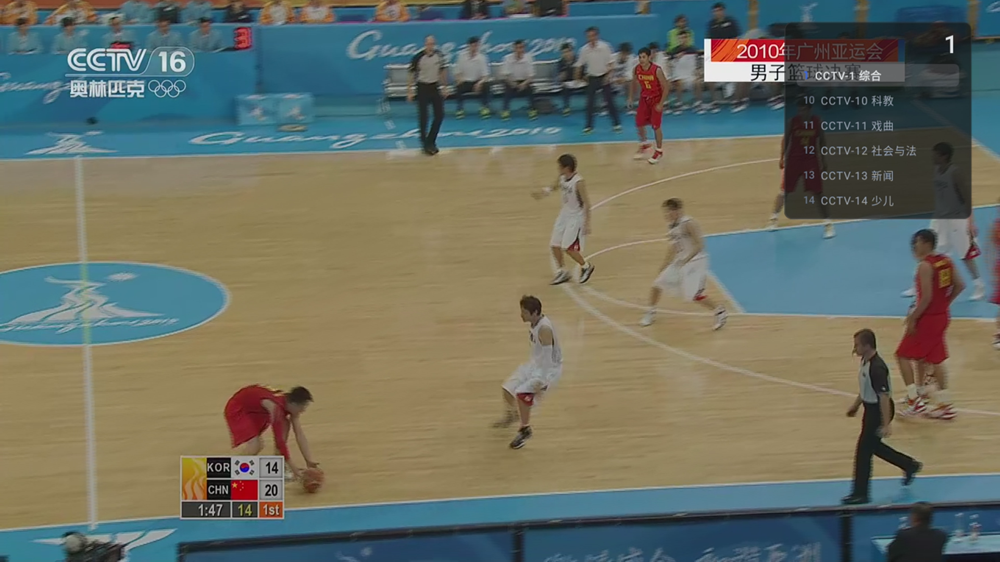
   
  <b>数字键直达换台 · 右上角实时匹配候选频道（支持上下方向键高亮直选）</b>

> 可在电视端 **「设置 → 遥控设置」** 自由录制任意功能的短按或长按绑定，详细指南见 [**Wiki 遥控器说明**](https://zqs1qiwan.github.io/iqtvlite/#zh/ui-remote)。
